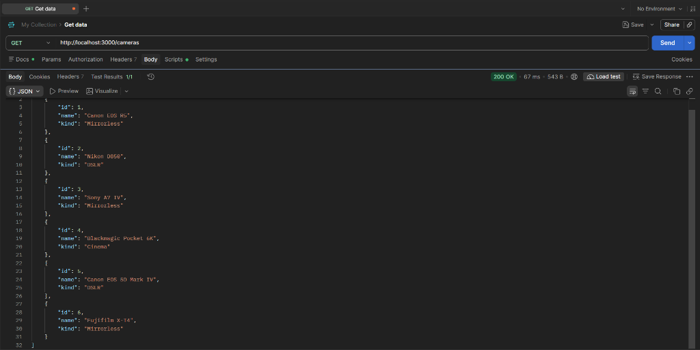
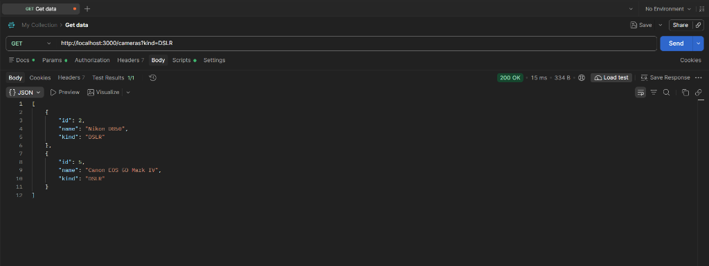
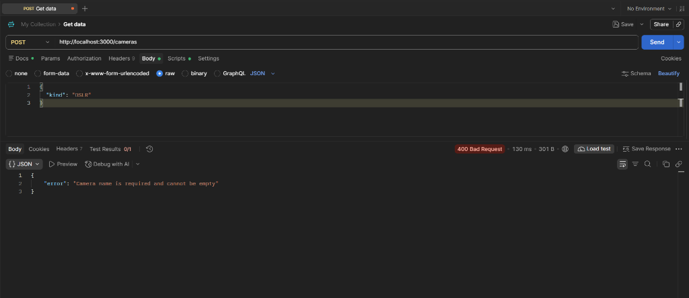
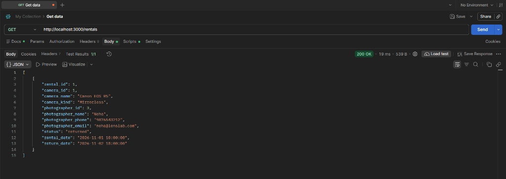
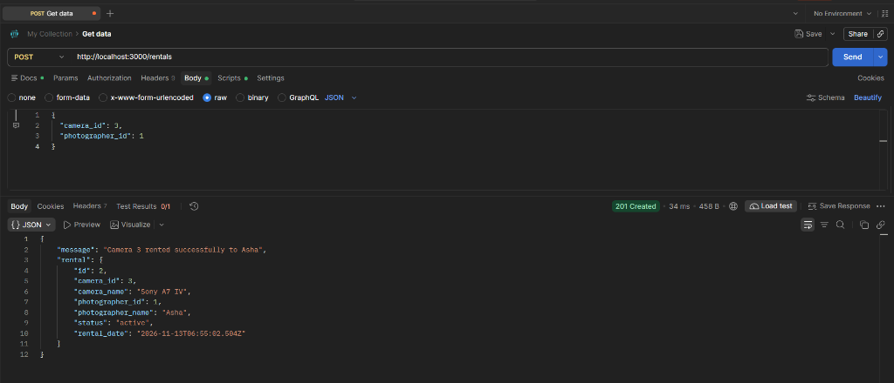
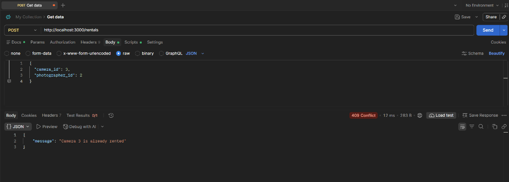
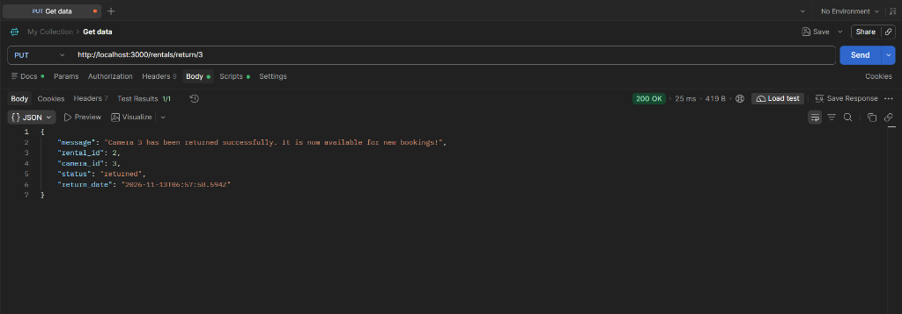
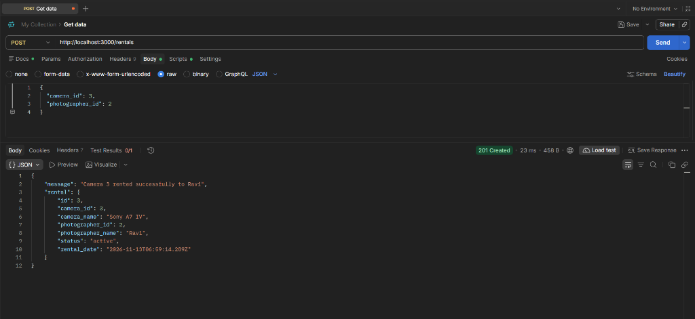
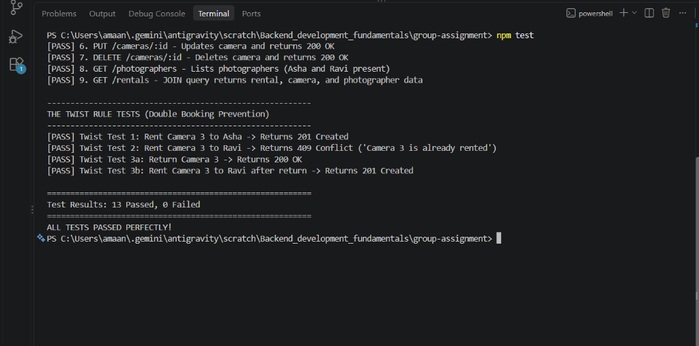

# LensLab Studio - Camera Rental System

> **Group:** LG-5 (`JP-GAI2B-G05`)  
> **Section:** CSE-GEN-AI 2B (`GAI2B`)  
> **Theme:** Theme 5 — Camera Rental (LensLab Studio)  
> **Submission / Demo Day:** Monday, 16 November  

---

## 1. Client Brief & Problem Statement

**Client Problem:**  
> *"Our cameras are lent by phone call. Two photographers turned up for the same camera on the same day. Please build us a system that fixes this."*

**Our Solution:**  
We developed a complete REST API backend powered by **Express.js** and **SQLite3** for LensLab Studio. The system maintains photographers, camera inventory, and active rental contracts. Most importantly, it enforces **The Twist Rule** to ensure zero double-booking conflicts:
1. A camera can **never** be rented to two active photographers at the same time.
2. If another photographer tries to rent an occupied camera, the API immediately rejects the request with **HTTP 409 Conflict** and the exact message: `"Camera {id} is already rented"`.
3. Once the camera is returned via the return endpoint, it becomes available again for new rentals.

---

## 2. Team Members & Task Contributions

As per project guidelines, the 6 core development tasks are distributed among our 4 team members:

| Member Name | Student ID | Assigned Tasks | Responsibility Summary |
| :--- | :---: | :---: | :--- |
| **Mohammed Amaan** | **9098** | **Task 1 & Task 5** | • **Task 1:** Express application setup, routing structure, middleware, error handling, and server initialization.<br>• **Task 5 (The Twist Rule):** Business logic preventing double bookings (`409 Conflict`) and camera return lifecycle. |
| **Pavan Kumar** | **9099** | **Task 2 & Task 3** | • **Task 2:** SQLite database design, 3 related tables (`photographers`, `cameras`, `rentals`), and database seeding (`init-db.js`).<br>• **Task 3:** REST CRUD endpoints for `cameras` and the SQL `JOIN` endpoint (`GET /rentals`). |
| **Chandu** | **9100** | **Task 4** | • **Task 4:** Input validation returning `400 Bad Request` with clear error messages, and query parameter search filtering (`GET /cameras?kind=DSLR`). |
| **Rakshit** | **9087** | **Task 6** | • **Task 6:** Automated test runner (`test-assignment.js`), Postman test cases, API documentation, and presentation guide. |

---

## 3. Database Schema (`lenslab.db`)

The database consists of three relational tables:

```
+--------------------+        +--------------------+        +--------------------+
|   photographers    |        |      rentals       |        |      cameras       |
+--------------------+        +--------------------+        +--------------------+
| id (PK, AutoInc)   |<---+   | id (PK, AutoInc)   |   +--->| id (PK, AutoInc)   |
| name TEXT NOT NULL |    +---| photographer_id    |   |    | name TEXT NOT NULL |
| phone TEXT         |        | camera_id          |---+    | kind TEXT NOT NULL |
| email TEXT         |        | status TEXT        |        +--------------------+
+--------------------+        | rental_date TEXT   |
                              | return_date TEXT   |
                              +--------------------+
```

### Table Definitions:
1. **`photographers`**: Stores client photographers (e.g., Asha, Ravi, Neha, Arjun).
2. **`cameras`**: Stores cameras with fields `name` and `kind` (e.g., DSLR, Mirrorless, Cinema).
3. **`rentals`**: Junction table linking a photographer and a camera, with a `status` flag (`'active'` or `'returned'`) and timestamps.

---

## 4. API Endpoints Reference

### Base & Cameras CRUD (Tasks 1, 3, 4)
| Method | Endpoint | Query / Body | Success Status | Description |
| :--- | :--- | :--- | :---: | :--- |
| `GET` | `/` | None | `200 OK` | Welcome message and API directory |
| `GET` | `/cameras` | None | `200 OK` | Get all cameras in inventory |
| `GET` | `/cameras?kind=DSLR` | `kind=DSLR` | `200 OK` | Filter cameras by type (e.g., `DSLR`, `Mirrorless`) |
| `GET` | `/cameras/:id` | None | `200 OK` / `404` | Get single camera by ID |
| `POST` | `/cameras` | `{ "name": "...", "kind": "..." }` | `201 Created` / `400` | Add new camera (validates required fields) |
| `PUT` | `/cameras/:id` | `{ "name": "...", "kind": "..." }` | `200 OK` / `400` / `404` | Update camera name or kind |
| `DELETE` | `/cameras/:id` | None | `200 OK` / `404` | Remove camera from inventory |

### Photographers & JOIN Route (Tasks 1, 3)
| Method | Endpoint | Query / Body | Success Status | Description |
| :--- | :--- | :--- | :---: | :--- |
| `GET` | `/photographers` | None | `200 OK` | List registered photographers |
| `POST` | `/photographers` | `{ "name": "...", "email": "..." }` | `201 Created` | Register new photographer |
| `GET` | `/rentals` | None | `200 OK` | **JOIN Endpoint:** Rentals joined with camera name & photographer name |

### The Twist Endpoints — No Double Booking (Task 5)
| Method | Endpoint | Body | Status | Description |
| :--- | :--- | :--- | :---: | :--- |
| `POST` | `/rentals` | `{ "camera_id": 3, "photographer_id": 1 }` | `201 Created` | Rents Camera 3 to Asha (if available) |
| `POST` | `/rentals` | `{ "camera_id": 3, "photographer_id": 2 }` | `409 Conflict` | Refuses rental if Camera 3 is active: `"Camera 3 is already rented"` |
| `PUT` | `/rentals/return/:cameraId` | None | `200 OK` | Returns camera, freeing it for future rentals |

---

## 5. Quick Start & Setup Guide

### Step 1: Open the Project Folder
Open terminal and navigate to the project folder:
```bash
cd group-assignment
```

### Step 2: Install Dependencies
```bash
npm install
```

### Step 3: Initialize Database & Seed Sample Records
```bash
npm run init-db
```
*(This creates `lenslab.db` with Asha as ID 1, Ravi as ID 2, and Sony A7 IV as Camera ID 3).*

### Step 4: Start the Express Server
```bash
npm start
```
The server will start at: `http://localhost:3000/`

### Step 5: Run Automated Tests
In a second terminal window:
```bash
npm test
```
All automated test cases will run and output pass/fail statuses.

---

## 6. The Twist Rule Verification (Demo Day Walkthrough)

To verify the core business rule on Demo Day, execute these 3 exact steps:

### Test 1: Rent Camera 3 to Asha
- **Request:** `POST http://localhost:3000/rentals`
- **Body (JSON):**
  ```json
  {
    "camera_id": 3,
    "photographer_id": 1
  }
  ```
- **Response:** `201 Created`
  ```json
  {
    "message": "Camera 3 rented successfully to Asha",
    "rental": {
      "id": 2,
      "camera_id": 3,
      "camera_name": "Sony A7 IV",
      "photographer_id": 1,
      "photographer_name": "Asha",
      "status": "active"
    }
  }
  ```

### Test 2: Rent Camera 3 to Ravi (Double-Booking Attempt)
- **Request:** `POST http://localhost:3000/rentals`
- **Body (JSON):**
  ```json
  {
    "camera_id": 3,
    "photographer_id": 2
  }
  ```
- **Response:** `409 Conflict`
  ```json
  {
    "message": "Camera 3 is already rented"
  }
  ```

### Test 3: Return Camera 3, then Rent to Ravi
- **Step 3A (Return Camera 3):**
  - **Request:** `PUT http://localhost:3000/rentals/return/3`
  - **Response:** `200 OK`
    ```json
    {
      "message": "Camera 3 has been returned successfully. It is now available for new bookings!",
      "status": "returned"
    }
    ```
- **Step 3B (Rent to Ravi):**
  - **Request:** `POST http://localhost:3000/rentals`
  - **Body (JSON):**
    ```json
    {
      "camera_id": 3,
      "photographer_id": 2
    }
    ```
  - **Response:** `201 Created`
    ```json
    {
      "message": "Camera 3 rented successfully to Ravi",
      "rental": {
        "camera_id": 3,
        "photographer_id": 2,
        "photographer_name": "Ravi",
        "status": "active"
      }
    }
    ```

---

## 7. Postman Screenshot Guide for Submission

Take screenshots of the following requests in Postman to document all tasks:

| # | Screenshot Name | Method & URL | Body / Query | What to Capture in Screenshot |
| :-: | :--- | :--- | :--- | :--- |
| **SS-1** | `01_cameras_list.png` | `GET http://localhost:3000/cameras` | None | Status `200 OK`, JSON array of all 6 cameras |
| **SS-2** | `02_query_param_dslr.png` | `GET http://localhost:3000/cameras?kind=DSLR` | None | Status `200 OK`, only DSLR cameras returned |
| **SS-3** | `03_validation_error.png` | `POST http://localhost:3000/cameras` | `{ "kind": "DSLR" }` | Status `400 Bad Request`, error message |
| **SS-4** | `04_join_rentals.png` | `GET http://localhost:3000/rentals` | None | Status `200 OK`, joined photographer + camera names |
| **SS-5** | `05_twist_test1_asha.png` | `POST http://localhost:3000/rentals` | `{ "camera_id": 3, "photographer_id": 1 }` | Status `201 Created`, Asha rented Camera 3 |
| **SS-6** | `06_twist_test2_ravi_conflict.png` | `POST http://localhost:3000/rentals` | `{ "camera_id": 3, "photographer_id": 2 }` | Status `409 Conflict`, `"Camera 3 is already rented"` |
| **SS-7** | `07_twist_test3a_return_camera.png`| `PUT http://localhost:3000/rentals/return/3` | None | Status `200 OK`, Camera 3 returned |
| **SS-8** | `08_twist_test3b_rent_to_ravi.png` | `POST http://localhost:3000/rentals` | `{ "camera_id": 3, "photographer_id": 2 }` | Status `201 Created`, Camera 3 rented to Ravi after return |
| **SS-9** | `09_npm_test_terminal.png` | `npm test` | None | Terminal showing all 13 test suites passing |

---

## 8. Verification Screenshots

### Screenshot 1: GET /cameras (All Cameras Inventory)


### Screenshot 2: GET /cameras?kind=DSLR (Filter by Query Parameter)


### Screenshot 3: POST /cameras Validation Error (400 Bad Request)


### Screenshot 4: GET /rentals (Relational JOIN Endpoint)


### Screenshot 5: The Twist Test 1 - Rent Camera 3 to Asha (201 Created)


### Screenshot 6: The Twist Test 2 - Attempt Double Booking to Ravi (409 Conflict)


### Screenshot 7: The Twist Test 3A - Return Camera 3 (200 OK)


### Screenshot 8: The Twist Test 3B - Rent Camera 3 to Ravi after Return (201 Created)


### Screenshot 9: Automated Verification Suite (npm test - 13/13 Passed)


