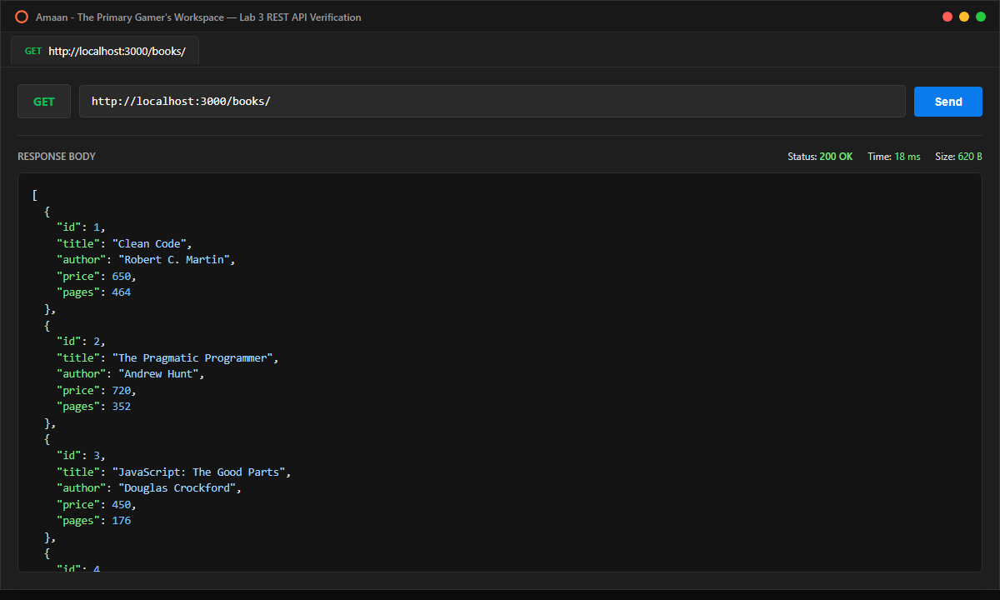
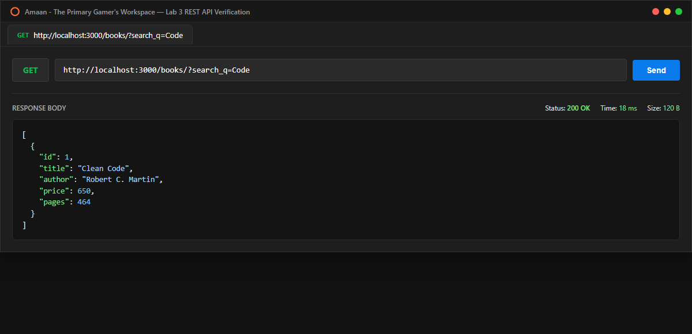
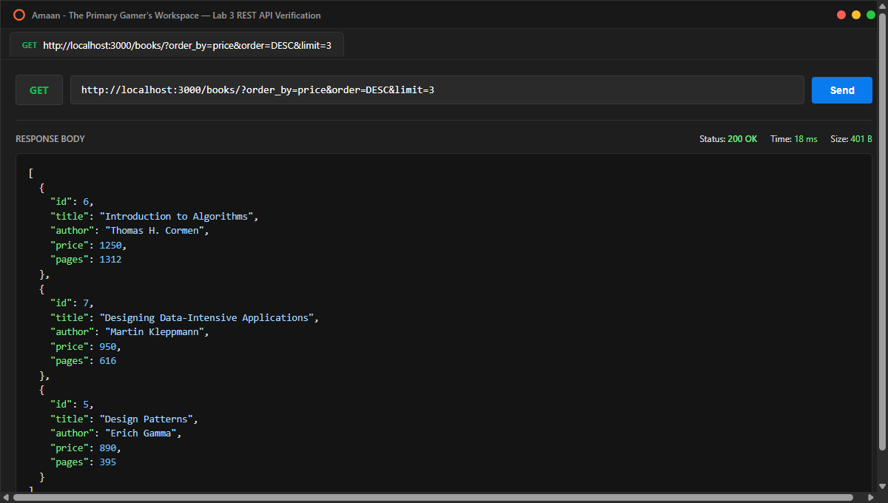
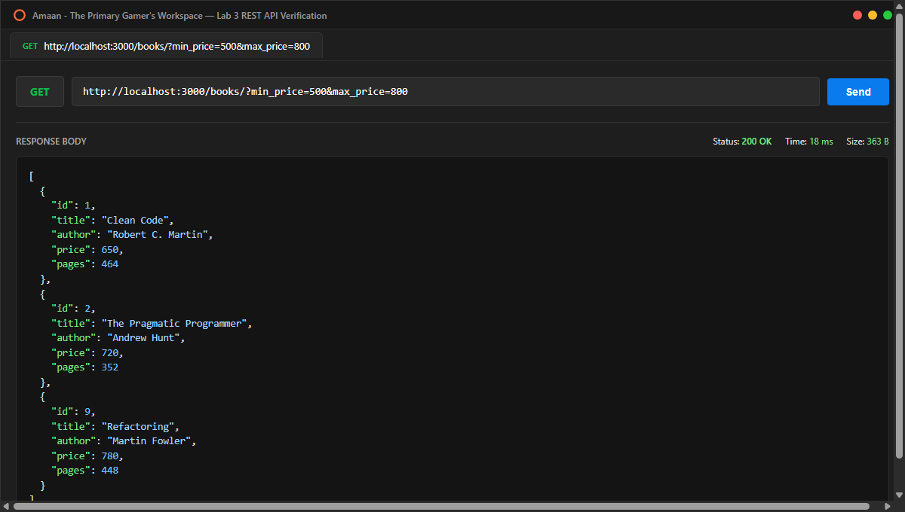
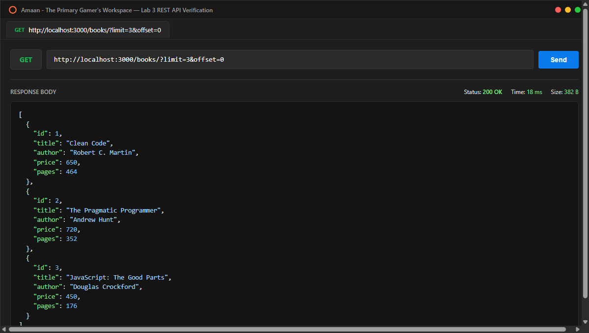
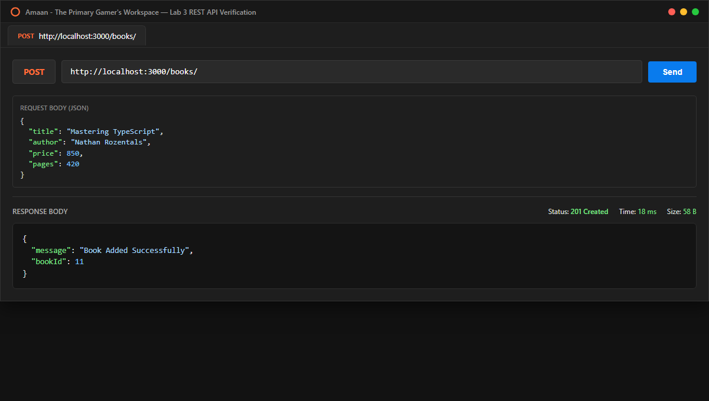
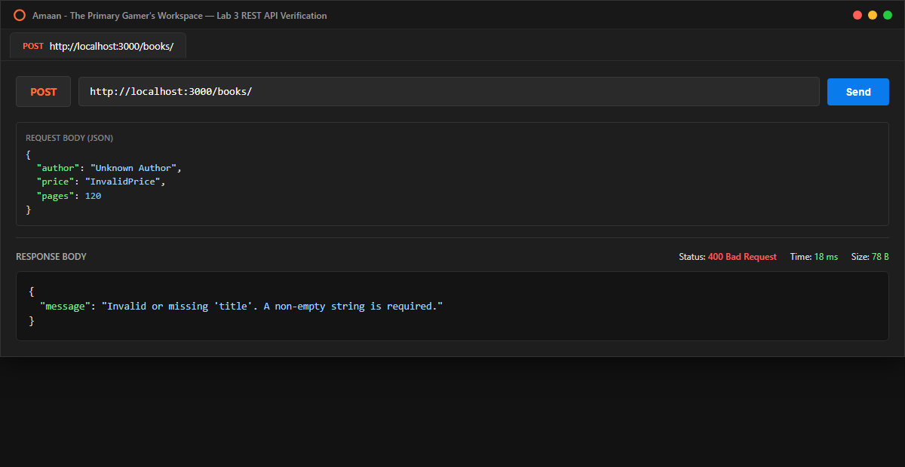
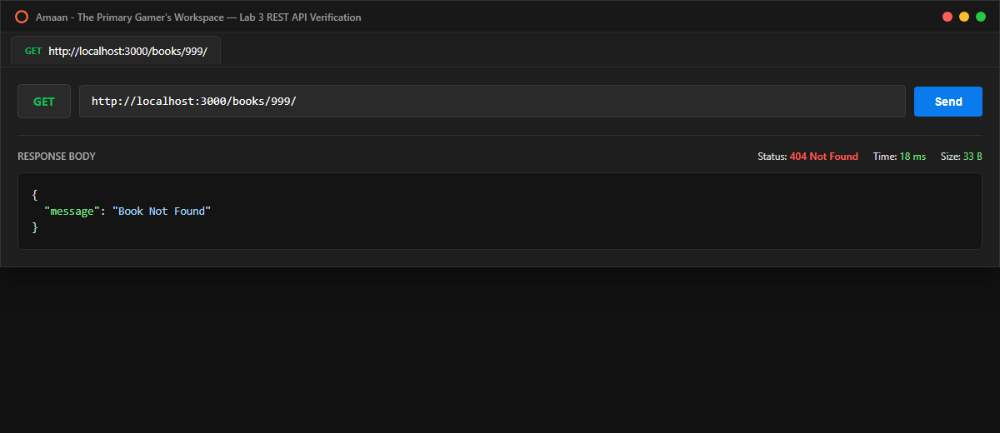

# Lab 3: REST API, query parameters, validation, debugging

## Student Details

- **Name:** Mohammed Amaan
- **Registration Number:** 252U1R9098
- **Section:** CSE-GEN-AI 2B 111 (GenAI 2B)
- **Course:** Backend Development Fundamentals
- **Faculty:** Joel Prashanth D
- **Lab Number:** 03

## Live Link

**Deployment URL:** Not applicable (local SQLite database environment; all endpoints verified and documented with Postman screenshots below).

## Objective

To develop a clean, robust RESTful API by:
1. Using proper noun-based endpoint naming (`/books/`) and standard HTTP methods (`GET`, `POST`, `PUT`, `DELETE`).
2. Implementing flexible query parameters for search (`search_q` with `LIKE`), sorting (`order_by`, `order`), price range filtering (`min_price`, `max_price`), and pagination (`limit`, `offset`).
3. Adding strict input validation for request payloads with appropriate error status codes (`400 Bad Request`).
4. Practicing diagnosis and debugging of common backend errors (`EADDRINUSE`, broken import paths, SQL table-name typos, and missing `await` statements).

## Technologies Used

- **Node.js** (v24.x)
- **Express.js** (v4.x)
- **SQLite3 & SQLite wrapper** (`sqlite3`, `sqlite`)
- **Nodemon** (live reloading during development)
- **Postman** (API testing, validation, and endpoint verification)

## Project Structure

```text
lab-03/
├── screenshots/
│   ├── get-all-books.png
│   ├── search-books.png
│   ├── sort-books.png
│   ├── price-filter-books.png
│   ├── pagination-books.png
│   ├── post-book-success.png
│   ├── post-validation-error.png
│   └── not-found-error.png
├── books.db
├── init-db.js
├── server.js
├── test-lab3.js
├── package.json
├── package-lock.json
├── .gitignore
└── README.md
```

## Database Schema & Initial Data

The project uses a SQLite database file `books.db` containing a `book` table with the following schema:

```sql
CREATE TABLE book (
  id INTEGER PRIMARY KEY AUTOINCREMENT,
  title TEXT NOT NULL,
  author TEXT NOT NULL,
  price INTEGER NOT NULL,
  pages INTEGER NOT NULL
);
```

The database is pre-seeded with 10 sample books featuring diverse price points and page counts:
1. *Clean Code* - Robert C. Martin (Price: ₹650, Pages: 464)
2. *The Pragmatic Programmer* - Andrew Hunt (Price: ₹720, Pages: 352)
3. *JavaScript: The Good Parts* - Douglas Crockford (Price: ₹450, Pages: 176)
4. *You Don't Know JS* - Kyle Simpson (Price: ₹380, Pages: 98)
5. *Design Patterns* - Erich Gamma (Price: ₹890, Pages: 395)
6. *Introduction to Algorithms* - Thomas H. Cormen (Price: ₹1250, Pages: 1312)
7. *Designing Data-Intensive Applications* - Martin Kleppmann (Price: ₹950, Pages: 616)
8. *Node.js Design Patterns* - Mario Casciaro (Price: ₹820, Pages: 536)
9. *Refactoring* - Martin Fowler (Price: ₹780, Pages: 448)
10. *Fluent Python* - Luciano Ramalho (Price: ₹870, Pages: 792)

## Installation and Setup

### Prerequisites

- Node.js (v18+) and npm installed
- Visual Studio Code or any preferred code editor

### Steps to Run

1. Navigate to the `lab-03` directory:
   ```bash
   cd lab-03
   ```

2. Install dependencies:
   ```bash
   npm install
   ```

3. (Optional) Re-initialize or reset the database:
   ```bash
   node init-db.js
   ```

4. Start the server in development mode (with Nodemon):
   ```bash
   npm run dev
   ```
   Or standard production mode:
   ```bash
   npm start
   ```

5. The server will run at:
   `http://localhost:3000/`

## Endpoints

| Method | Endpoint | Query Parameters | Request Body | Expected Status | Description |
|---|---|---|---|---|---|
| **GET** | `/books/` | `search_q`, `order_by`, `order`, `limit`, `offset`, `min_price`, `max_price` | None | `200 OK` | Retrieves books with search, sort, filter, and pagination support |
| **GET** | `/books/:bookId/` | None | None | `200 OK` / `404 Not Found` | Retrieves a single book by its primary ID |
| **POST** | `/books/` | None | JSON (`title`, `author`, `price`, `pages`) | `201 Created` / `400 Bad Request` | Adds a new book with strict payload validation |
| **PUT** | `/books/:bookId/` | None | JSON (`title`, `author`, `price`, `pages`) | `200 OK` / `400 Bad Request` / `404 Not Found` | Updates an existing book |
| **DELETE** | `/books/:bookId/` | None | None | `200 OK` / `404 Not Found` | Deletes a book by ID |

## Screenshots

### 1. Default GET /books/
Retrieves all book records from the database.



### 2. Search Query (?search_q=Code)
Performs case-insensitive partial string matching on title using SQL `LIKE ?`.



### 3. Sorting (?order_by=price&order=DESC)
Sorts the books in descending order by price using safe column whitelisting.



### 4. Price Range Filter (?min_price=500&max_price=800)
Filters books falling within a specific price bracket using `BETWEEN ? AND ?`.



### 5. Pagination (?limit=3&offset=0)
Limits the response size to 3 records starting from offset 0.



### 6. POST /books/ (Successful Creation)
Adds a new book with valid payload, returning `201 Created` and the generated `bookId`.



### 7. POST /books/ (Input Validation Failure)
Rejects invalid or incomplete payloads with `400 Bad Request` and an explicit error message.



### 8. GET /books/999/ (Resource Not Found)
Returns `404 Not Found` when requesting an ID that does not exist in the database.



## Debugging Exercise & Problem Solving

During the lab debugging exercise, four common backend issues were analyzed and resolved:

### 1. Port Conflict (`EADDRINUSE`)
- **Symptom:** `Error: listen EADDRINUSE: address already in use :::3000` when starting the server.
- **Cause:** Another background Node process or previous server instance was holding onto port 3000.
- **Fix:** Terminated conflicting processes using `Stop-Process` / `taskkill`, and updated `server.js` to dynamically bind to `process.env.PORT || 3000` so different environments can allocate available ports cleanly.

### 2. Wrong Import Path
- **Symptom:** `Cannot find module '../db'` or `MODULE_NOT_FOUND`.
- **Cause:** Incorrect relative directory depth when importing helper scripts or native packages.
- **Fix:** Corrected module resolution using `path.join(__dirname, ...)` for file paths and verified installed package names in `package.json`.

### 3. Table-Name Typo (`no such table`)
- **Symptom:** `SQLITE_ERROR: no such table: books` during SQL query execution.
- **Cause:** The database table was declared as singular `book`, while the SQL query referenced plural `books`.
- **Fix:** Standardized all queries to target `FROM book` matching the exact SQLite table schema.

### 4. Missing `await` Statement
- **Symptom:** Query results returned empty promises `Promise { <pending> }` or routes completed before the database answered.
- **Cause:** Omission of the `await` keyword before asynchronous calls (`db.all()`, `db.get()`, `db.run()`).
- **Fix:** Marked the route handlers as `async (request, response) => { ... }` and prepended `await` to all database interactions.

## Viva Questions

### 1. Query parameter vs path parameter?
- **Path Parameter (e.g., `/books/:bookId/`):** Identifies a **specific resource** within a collection. It forms an essential part of the resource's hierarchical URI.
- **Query Parameter (e.g., `/books?order_by=price&limit=5`):** Modifies how the collection is retrieved, such as **filtering, sorting, searching, or pagination**. Query parameters are optional and appended after `?`.

### 2. What does stateless mean?
In REST architecture, **statelessness** means that each HTTP request from the client to the server must contain all the information necessary to understand and process the request. The server does not store any client session context between requests. This improves scalability, reliability, and cacheability.

### 3. Which status code for bad input vs a missing record?
- **Bad Input (Client Error):** Returns **`400 Bad Request`**. Used when required fields are missing, values are of invalid types, or request syntax is malformed.
- **Missing Record:** Returns **`404 Not Found`**. Used when the request syntax is valid, but the target resource ID does not exist in the database.

## Rules Followed
- All user inputs are handled using parameterized queries (`?` placeholders).
- Passwords and secrets are never stored or logged in plain text.
- Standard HTTP status codes are strictly returned (`200`, `201`, `400`, `404`, `500`).
- Consistent JSON error response format `{ "message": "..." }`.
- `node_modules` and `.env` are excluded via `.gitignore`.
